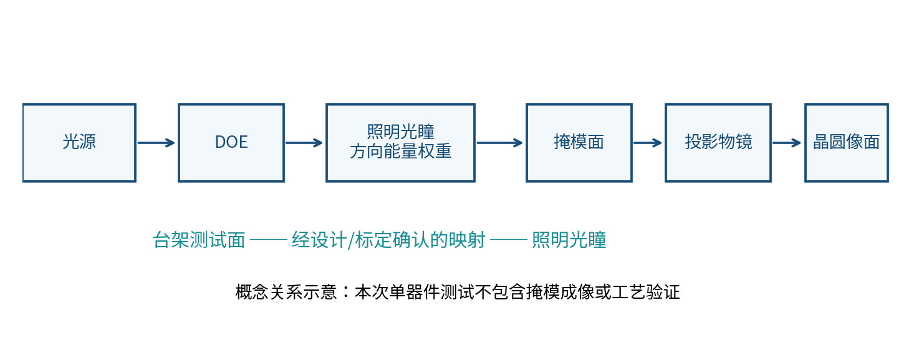
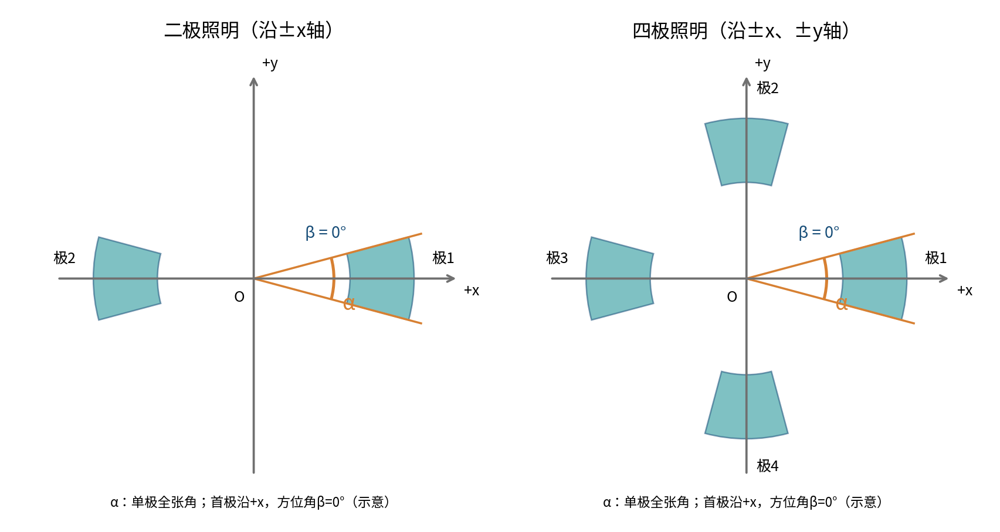
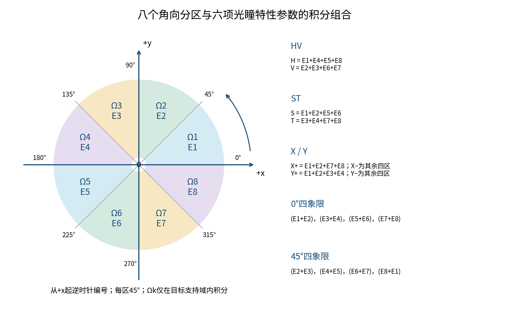
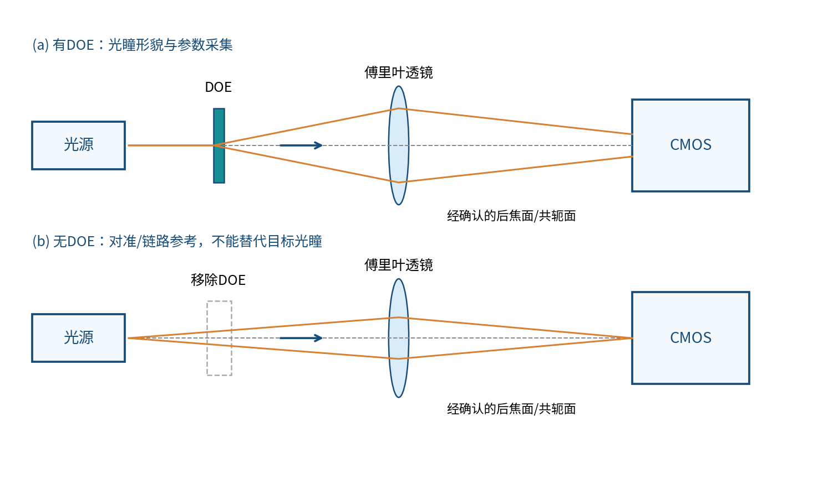
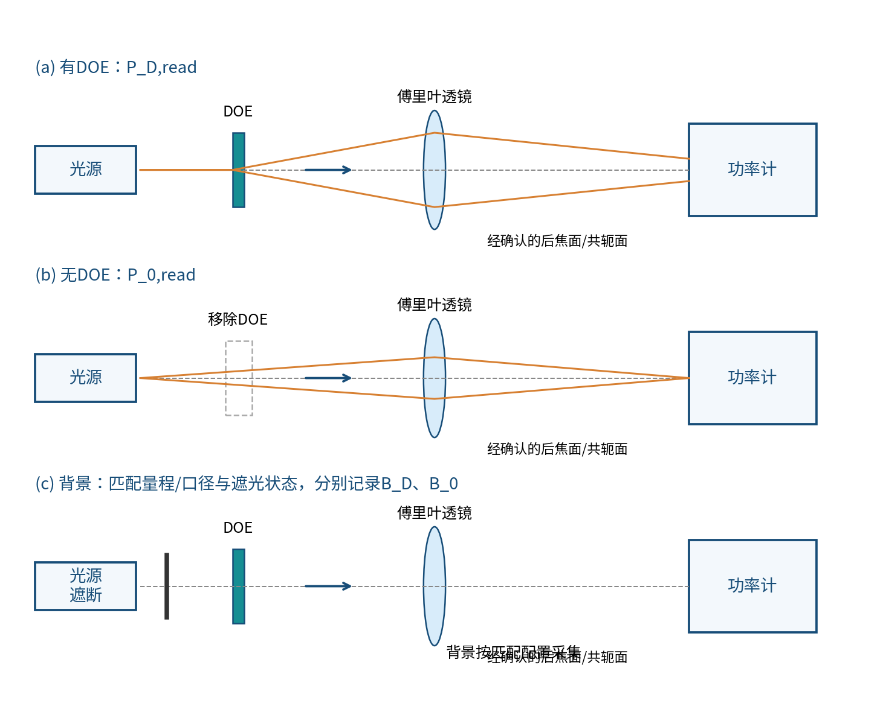
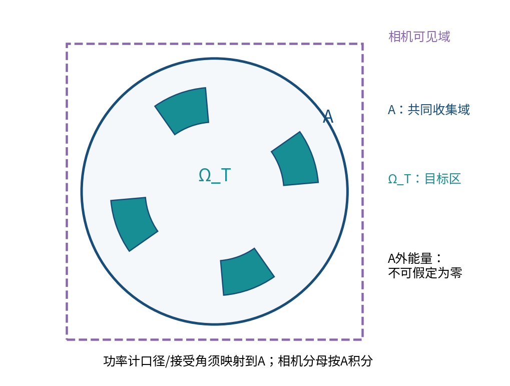

# DOE测试验收方案

**单器件测试｜评审稿 v0.1｜2026年11月12日**

本方案按用户提供模板的四章框架编制，用于规定拟开展的测试、数据处理与验收方法。尚未进行本器件的实际测试，不含实测结果或合格结论。所有指标目标值和允许公差数值以 **？？？** 表示，单位和判定方向另列。六项光瞳特性参数名称已由用户确认；其计算分区、归一化方式及本文角度约定属于拟采用方法，须在正式验收前确认。未完成这些确认和阈值填充前，本稿不能直接作为最终判退依据。

## 目录

一、项目概述：1.1 项目背景；1.2 光学指标需求分析；1.3 技术难点分析。

二、现有技术调研与分析：2.1 现有技术案例一；2.2 仿真数据一。

三、拟采用方案：3.1 方案具体实施步骤；3.2 方案执行规划；3.3 方案可行性分析；3.4 核心算法或计算方案。

四、方案预期测试结果。

文末集中列参考文献与资料。

## 一、项目概述

### 1.1 项目背景

衍射光学元件（DOE）通过空间相位或振幅分布改变出射光场。本项目测试对象为单个用于投影光刻照明系统光瞳整形的 DOE，设计采用 Gerchberg–Saxton（GS）算法，理论验证采用标量衍射模型。验收目的在于确认：器件在规定入射条件和测试配置下，是否形成所要求的照明光瞳形貌、能量分配及角向几何特征；相应加工尺寸是否符合设计要求。

照明光瞳描述不同照明方向的能量权重，与掩模面上的照度分布、晶圆像面上的图形强度分布是不同对象。投影成像还受掩模频谱、物镜孔径与像差、离焦、偏振和相干条件影响。[4] 本方案不把 DOE 单器件光场图解释为晶圆成像，也不据此宣称分辨率、焦深、线宽控制或工艺窗口已改善。

拟采用“光源—DOE—傅里叶透镜—CMOS”获取测试面二维光强，并通过已确认的共轭关系、坐标映射和标定解释为系统照明光瞳；以“光源—DOE—傅里叶透镜—功率计”取得积分功率，结合相机图像的目标能量占比计算所约定的效率。尚未建立系统映射时，只能称为测试面分布，相关系统光瞳指标保持待验证。

器件加工验收包括横向 CD、套刻误差、刻蚀深度与整体尺寸。应以同一器件标识、设计版本和方向基准串联光学与结构记录，但不能仅凭结构尺寸合格推断光学指标必然合格。

### 1.2 光学指标需求分析

指标共分六项光瞳特性参数、三项其他光学指标和四项结构指标。六项参数为：HV 椭圆度、ST 椭圆度、X 极平衡、Y 极平衡、0° 四象限极平衡、45° 四象限极平衡。不得以均匀性、质心或半径等其他量替代这六项；后者如被计算，仅作为诊断辅助量。

本稿对 HV/ST 椭圆度提出角向能量差的候选定义，不能理解为几何椭圆长短轴比。对 X/Y 极平衡提出左右/上下能量差的候选定义；对两项四象限极平衡提出旋转分区后的最大不平衡量。名称本身不足以唯一确定这些公式，最终需与设计方的指标表或计算规范对齐。正式执行前冻结定义版本，不得在看到结果后更换公式。

| 指标 | 拟评价量及方法 | 目标/下限 | 允许公差/上限 | 单位与当前状态 |
| --- | --- | --- | --- | --- |
| HV椭圆度 | 水平/垂直角区能量相对偏差；CMOS积分 | **？？？** | **？？？** | %；候选定义待确认 |
| ST椭圆度 | 两组对角方向角区能量相对偏差；CMOS积分 | **？？？** | **？？？** | %；S/T方向与候选定义待确认 |
| X极平衡 | 右/左半域目标能量相对偏差；CMOS积分 | **？？？** | **？？？** | %；候选定义待确认 |
| Y极平衡 | 上/下半域目标能量相对偏差；CMOS积分 | **？？？** | **？？？** | %；候选定义待确认 |
| 0°四象限极平衡 | 0°分区四组能量的最大不平衡；CMOS积分 | **？？？** | **？？？** | %；分区起始边界待确认 |
| 45°四象限极平衡 | 旋转45°分区四组能量的最大不平衡；CMOS积分 | **？？？** | **？？？** | %；候选定义待确认 |
| 衍射效率 | 目标功率/约定参考功率；功率计结合相机占比 | ≥ **？？？** | 允许偏差 **？？？** | %；参考平面与损耗边界待确认 |
| 极张角 | 二极/四极中单极角向边界的全张角；CMOS计算 | **？？？** | ± **？？？** | °；边缘提取准则待确认 |
| 方位角 | 二极/四极指定首极中心方向相对基准轴的角度 | **？？？** | ± **？？？** | °；机械基准和极编号待确认 |
| 横向CD | 指定层级、方向与边缘口径的线宽/间距；SEM | **？？？** | ± **？？？** | nm或μm；按设计统一一种 |
| 套刻误差 | 指定层对相对设计位移的残差；SEM/显微镜 | **？？？** | ± **？？？** | nm或μm；分量及合成判据待确认 |
| 刻蚀深度 | 指定相邻平台或指定级次的高度差；台阶仪/AFM | **？？？** | ± **？？？** | nm或μm；台阶定义待确认 |
| DOE整体尺寸 | 设计规定的外形及其他指定尺寸 | **？？？** | ± **？？？** | mm；尺寸项与工具待确认 |

表中“目标/下限”和“公差/上限”按指标最终选择适用栏，不能同时叠加为两套判据。六项候选量中，带符号差值建议按其与目标值的偏差判定；非负最大不平衡量建议按上限判定。若设计方采用比值型椭圆度或其他平衡公式，必须整体替换定义、单位表达和判定方向，不能只替换目标数值。

所有指标均附适用条件、有效数据规则、测点/极区、独立采样定义和不确定度。单位选择不确定不等于可混用；设计尺寸以 nm 或 μm 冻结后，处理程序与表头保持一致。

### 1.3 技术难点分析

第一，测试面并不自动等同系统光瞳。需要明确 CMOS 是否位于傅里叶透镜后焦面、是否存在中继放大、坐标旋转/镜像以及与照明光瞳的对应关系。像素尺度、光轴和系统基准轴误差会直接影响分区积分与角度测量。

第二，六项参数容易因分区、名称或归一化差异而得到不可比结果。特别是 HV/ST 椭圆度可能采用能量比或归一化差，四象限指标可能采用逐区偏差、最大最小差或其他定义。应以“图示分区＋公式＋单位＋版本”整体确认，不能仅填一个指标名称。

第三，效率测量的图像分母与功率计收集域必须一致。相机有限视场、透镜截光和离轴探测响应会造成能量遗漏；相机 DN 也不能未经标定当作瓦特。无 DOE 参考光路和器件入射面功率代表不同分母，不能混称本征效率。

第四，光瞳边界不是理想二值线。背景、衍射边缘、旁瓣、散斑、饱和和噪声会影响张角与方位角。需预定角向强度构建、边缘阈值或拟合模型，量化规则敏感性，不以调整阈值使结果达标。

第五，结构测试具有取样与仪器局限。SEM 充电、镀膜和倾斜影响 CD；显微镜是否有足够套刻测量能力须验证；台阶仪/AFM 探针可能不能进入狭窄沟槽。标记区测量也不自动代表整个有效区域。

第六，验收规则需区分器件不合格和测量无效。饱和、截光、分母信噪不足、校准过期或不确定度过大时，应标“无效/不可判定”，而非凭一个数值直接判退。

## 二、现有技术调研与分析

### 2.1 现有技术案例一

#### 2.1.1 GS设计与标量传播方法

GS 以两平面的振幅约束交替更新相位。设 DOE 输入面振幅为 A₀，目标强度为 T，则目标振幅为 √T。以传播算子 P 表示模型，基本迭代为：

Uₖ = A₀ exp(iφₖ)，Vₖ = P[Uₖ]；

V′ₖ = √T exp(i arg Vₖ)，φₖ₊₁ = arg(P⁻¹[V′ₖ])。

下一次迭代重新施加输入振幅约束。公开的 slmsuite 固定版本实现可支持这一流程说明。[1] 本器件用户仅确认采用 GS，不据该软件的其他功能假定本项目采用加权 GS、SLM 反馈或相机闭环。原始 GS 与 Fienup 论文全文在既有资料包中未取得，不将其写作已经核实的原文证据。

相位型薄元件可写成 U₀(x,y)=A_in(x,y)t(x,y)exp[iφ_DOE(x,y)]，其中 t 包含孔径和振幅透过率。标量角谱传播表示为：

U_z = F⁻¹{F[U₀] H_z}，H_z(fₓ,fᵧ)=exp[i2πz√(λ⁻²−fₓ²−fᵧ²)]。

此处 λ 为传播介质中的波长，采用 exp(−iωt) 时间约定，倏逝分量选择正向衰减分支。傍轴条件下可采用 Fresnel 近似，适用性需要根据实际波长、孔径和传播几何验证。[2]

理想薄透镜相位为 t_L=P_L exp[−ik(x²+y²)/(2f)]。若 DOE 到透镜距离为 d，透镜到探测面距离为 z，则使用 U_det=P_z{t_L·P_d[U₀]}；只有满足相应几何和近似条件时才简化为焦面傅里叶变换。[2–3] 后焦面强度与入射复场傅里叶变换模平方相关，傍轴坐标满足 fₓ=X/(λf)、fᵧ=Y/(λf)。不能仅凭器件排列顺序认定实际 CMOS 已准确处于该面。

#### 2.1.2 二极/四极的极张角与方位角

本次联网读取 TorchLitho 固定提交的 Source.py：CalculateQuasarSourceMatrix 在四组方向上采用中心角 ± openAngle/2 的支持域；CalculateDipoleSourceMatrix 采用 |cos(θ−rotateAngle)|≥cos(openAngle/2) 描述相对两极。[5] 该证据支持“极张角是单极在光瞳平面内所张的全角、方位描述极的方向”这一建模口径，不是任何仪器或合同的统一验收标准。

本文建议：用已标定光瞳中心 O 为角度顶点，+x 为起始方向，朝 +y 逆时针为正。第 j 极在环向能量分布中两条边界射线的角度为 θ_j,L、θ_j,R，极张角 α_j 为按该极局部连续角度展开后的差 θ_j,R−θ_j,L；方位角 β_j 为两条边界角的中值，再按约定周期表示。该几何中心定义不与能量质心方向混用。

二极建议按设计标记指定首极，另一极中心设计相差180°；四极建议以首极为起点依序编号，等间隔理想情况中心相差90°，不据此假定各极实测完全对称。整体方位角可对已识别的对称结构采用二阶/四阶角统计，但须保留逐极方向及装调基准。等权对称二极存在180°、四极存在90°的图形方向等价性；若机械标记明确首极，仍按标记报告完整方向。

仅在本项目确认的二极、四极照明中报告极张角和方位角；其他形态记不适用并说明理由。这里的 α、β 均为光瞳平面内形貌角，不是相对光轴的传播极角。台架位置与传播角的关系及系统光瞳映射另行标定。

#### 2.1.3 八分区及六项光瞳特性参数计算

六项名称已由用户确认。本节将其统一写为八个45°角向分区的能量积分组合，便于复核图像、分区编号与计算结果。下列归一化方式延续本评审稿的项目候选规则，不声称为统一行业标准；若已有设计方或验收方公式，应先对齐定义再填写目标和公差。角向分区与坐标参考可依照照明源的极坐标支持域表达建立，[5] 但该来源不规定本节六项指标的归一化公式。

**（1）坐标、八分区和积分量**

以标定后的光瞳中心 O 为原点，+x为0°，+y为90°，逆时针为正，θ=atan2(y,x)，按0°≤θ<360°表示。用x轴、y轴及两条对角线把光瞳划为八个角向分区；这里“八分区”是每区45°的八个扇区，不是八个笛卡尔象限。编号从+x上方的0°—45°区域起，依次逆时针为Ω₁至Ω₈。各分区还须与固定目标支持域Ω_T取交集，不假定图中整圆或环形就是实际光瞳。

Ω_k = Ω_T ∩ {(x,y)：45°(k−1)≤θ<45°k}，k=1，…，8。

E_k = E(Ω_k) = Σ_i w_i(Ω_k) C_i，S₈ = E₁+E₂+E₃+E₄+E₅+E₆+E₇+E₈。

E_k为第k区经匹配背景扣除及已验证响应校正后的相对能量积分；C_i为净线性像素信号，w_i为像元与该分区的面积交叠权重，数据处理详见3.4.1。原始DN积分不自动具有瓦特单位。分区边界采用半开归属或面积分配，不重复计数；原点不具有角度，落在其附近的有限像元须按面积分摊，不能由atan2(0,0)任意指定到某区。有效分区须满足ΣE_k=E(Ω_T)，误差仅限所声明的离散积分误差。

**（2）HV椭圆度**

将邻近±x方向的四区能量相加为H，邻近±y方向的四区能量相加为V：

H=E₁+E₄+E₅+E₈，V=E₂+E₃+E₆+E₇。

ε_HV = 100% × [(E₁+E₄+E₅+E₈)−(E₂+E₃+E₆+E₇)] / S₈。

该候选量等价于100%×(H−V)/(H+V)，正值表示水平角区能量较高，负值表示垂直角区能量较高。它描述角向能量分配，不是边界拟合椭圆的长短轴比。若设计方采用比值型椭圆度，另报告R_HV=H/V；R_HV以1为等能基准，ε_HV以0为等能基准，二者不能共用同一数值公差。

**（3）ST椭圆度**

本稿令S对应45°/225°对角方向，T对应135°/315°对角方向；与用户既有S/T命名不同时须统一调整符号及判据：

S=E₁+E₂+E₅+E₆，T=E₃+E₄+E₇+E₈。

ε_ST = 100% × [(E₁+E₂+E₅+E₆)−(E₃+E₄+E₇+E₈)] / S₈。

该候选量等价于100%×(S−T)/(S+T)，正负号反映两组对角能量的高低。若采用比值型定义，另报告R_ST=S/T。对于完全相同的分区，比值r与未乘百分数的归一化差d满足d=(r−1)/(r+1)；不能将两种定义的读数直接比较。

**（4）X极平衡**

定义右半域X⁺=E₁+E₂+E₇+E₈，左半域X⁻=E₃+E₄+E₅+E₆，则：

B_X = 100% × [(E₁+E₂+E₇+E₈)−(E₃+E₄+E₅+E₆)] / S₈。

该候选量等价于100%×(X⁺−X⁻)/(X⁺+X⁻)，正值表示右半域能量较高，零值表示左右等能，不等同于质心x坐标为零。若指标实际指某一对完整极而非左右半域，应先以设计极区ROI替换对应积分域，不将两种口径混用。

**（5）Y极平衡**

定义上半域Y⁺=E₁+E₂+E₃+E₄，下半域Y⁻=E₅+E₆+E₇+E₈，则：

B_Y = 100% × [(E₁+E₂+E₃+E₄)−(E₅+E₆+E₇+E₈)] / S₈。

该候选量等价于100%×(Y⁺−Y⁻)/(Y⁺+Y⁻)，正值表示上半域能量较高。X/Y极平衡均保留符号；如验收仅限制失衡幅度，则用其与规定目标的偏差绝对值进行判定，不在处理时提前抹去方向信息。

**（6）0°四象限极平衡**

本稿以象限边界的起始角命名“0°”：四个90°区间依次为[0°,90°)、[90°,180°)、[180°,270°)、[270°,360°)。其能量为：

Q₁⁽⁰⁾=E₁+E₂，Q₂⁽⁰⁾=E₃+E₄，Q₃⁽⁰⁾=E₅+E₆，Q₄⁽⁰⁾=E₇+E₈。

b_j⁽⁰⁾ = 100% × [4Q_j⁽⁰⁾/S₈−1]，j=1，2，3，4。

B_Q0 = max{|b₁⁽⁰⁾|，|b₂⁽⁰⁾|，|b₃⁽⁰⁾|，|b₄⁽⁰⁾|}。

即先计算各象限相对于四区平均能量S₈/4的有符号偏差，再取最大绝对偏差作为汇总量。应同时保留四个b_j，不能只保存最大值。该候选定义以0为等能基准，不等于“最大最小差除以总能量”。

**（7）45°四象限极平衡**

将上述四象限边界整体逆时针旋转45°：区间依次为[45°,135°)、[135°,225°)、[225°,315°)以及跨零的[315°,360°)∪[0°,45°)。其能量为：

Q₁⁽⁴⁵⁾=E₂+E₃，Q₂⁽⁴⁵⁾=E₄+E₅，Q₃⁽⁴⁵⁾=E₆+E₇，Q₄⁽⁴⁵⁾=E₈+E₁。

b_j⁽⁴⁵⁾ = 100% × [4Q_j⁽⁴⁵⁾/S₈−1]，j=1，2，3，4。

B_Q45 = max{|b₁⁽⁴⁵⁾|，|b₂⁽⁴⁵⁾|，|b₃⁽⁴⁵⁾|，|b₄⁽⁴⁵⁾|}。

两套四象限必须共用同一批E₁—E₈和同一S₈，不能各自调整光瞳中心、旋转样品或重新选择目标支持域。若现有规范用象限中心方向命名0°/45°，两套名称可能互换，应以已确认的图和角区表为准。

**（8）有效性和非等权目标**

六项参数均需S₈具有可信的正净信号；比值型辅助量还需各自分母有效。背景扣除后负值、饱和、截光或某些分区在特定二极目标中没有信号时，先按数据有效性和指标适用性规则处理，不把无效结果填0表示合格。目标和允许公差仍按1.2中的 **？？？** 填写，不从示意图或合成样例取得。

上面的四象限平衡以等权为参考。若目标各区本就不等权，可将逐区量改为100%×[(Q_j/S₈)/w_j−1]，其中w_j>0、Σw_j=1，权重来自冻结设计目标；零权区域另作杂散监测，不作除数。HV/ST/X/Y的非零设计偏置通过对应目标值评价，不通过重新划区消除偏差。所有公式、分区和符号版本在测试前冻结。

#### 2.1.4 调研证据与局限

本稿利用了既有研究包的官方实现节选和自写笔记，以及本次重新读取的照明源代码。文献[1–3]用于算法和传播模型；文献[4]基于包内讲义查阅笔记说明系统层级；文献[5]是本次直接核对的角向支持域实现。它们均不能提供本 DOE 的实测性能、仪器能力或合同验收阈值。

本次另尝试公开专利检索端点，但连接阶段收到代理403，未取得检索内容。故不列出未经查阅的专利案例，也不声称已完成全面文献或专利调研。六项特性参数的下述归一化公式为工程建议，不借上述文献冒充统一标准。

### 2.2 仿真数据一

本节按模板保留，但本器件真实相位、波长、入射场和加工参数尚未提供，当前没有可报告的本器件仿真数据。既有资料包中的 CSV 和结果均为合成演练，不移入本节充当真实设计输出。

正式理论验证拟按以下顺序进行：固定设计版本及摘要；确认输入振幅、偏振与相干假设；加载连续设计相位和实际量化相位；建立 DOE、透镜、孔径和 CMOS 像元积分模型；传播得到测试面强度；以同一标定域计算光瞳指标；进行采样收敛、能量账目和独立传播模型交叉检查。设计用同一个 FFT 再传播仅证明内部一致性，不能独立证明模型正确。

| 仿真项目 | 输入及处理 | 计划输出 | 当前状态 |
| --- | --- | --- | --- |
| 设计相位基线 | 实际入射场、连续设计相位 | 目标/预测光瞳及指标 | 未运行，缺设计输入 |
| 加工实现对比 | 量化级次、实际加工网格与高度—相位模型 | 制造引入的差异及敏感性 | 未运行，缺结构和材料参数 |
| 台架影响 | 孔径、离焦、倾斜、像元积分、波长范围 | 测量链路影响及校准需求 | 未运行，缺台架参数 |
| 数值验证 | 网格/窗口加密、解析基准或独立实现 | 收敛曲线与能量检查 | 待制定并执行 |

若透射浮雕薄相位模型适用，可采用 φ≈2π(n−n_env)h/λ₀ 将高度与相位关联，λ₀ 为真空波长。材料色散、反射、矢量耦合、近波长微结构和高 NA 条件可能使该模型不足，不能以标量仿真通过替代实物验收。

## 三、拟采用方案

### 3.1 方案具体实施步骤

#### 3.1.1 测试准备与共用条件

1. 登记样品 ID、设计版本、有效区、朝向、机械基准和表面状态；保留样品及设计原始记录。将被测器件与空白基片、参考件、合成夹具明确区分。
2. 在正式采集前确认本稿待定的指标公式、目标/公差、取样位置、独立重复次数、仪器校准和判定规则。不得将“待确认”视为已经满足。
3. 记录光源波长/谱宽、偏振、入射功率时序、束径及波前或准直条件；与设计条件不一致时说明影响，不直接套用设计目标。
4. 记录透镜焦距、有效孔径、光谱透过率证据及 DOE—透镜—探测面的实际位置；核查像差、截光和焦面位置。
5. 标定 CMOS 像元尺度、光轴位置、x/y 方向、镜像/旋转与必要畸变；以系统设计或实测标定建立测试面至照明光瞳的映射。不能以自由拟合把实测图强行拉伸到目标图。
6. 核对功率计探头波段、量程、有效口径、线性、角度响应和校准状态；曝光光束和聚焦功率密度须在设备允许范围内。需要衰减时仅采用有校准证据的元件，并登记实际位置和透过率。
7. 建议先完成不会改变器件的光学测试，再进行可能涉及镀膜、接触或样品制备的结构测试。具体顺序由样品兼容性决定，不默认 SEM 镀膜后仍可直接代表原器件光学状态。

#### 3.1.2 CMOS光瞳形貌与特性参数测试

采用光源—DOE—傅里叶透镜—CMOS 光路。CMOS 置于经确认的后焦面，或有明确中继映射的共轭面。图4中的光路与距离标注用于说明测量关系，不代表当前已完成搭建。

1. 在无 DOE 配置下建立直射参考轴和探测面位置，检查参考光是否饱和；无 DOE 图仅用于对准、背景与链路诊断，不作为目标光瞳。
2. 装入 DOE，按机械标记固定方向，记录安装位置；调整到预定测试面，不凭主观“图最漂亮”替代既定调焦规则。
3. 关闭自动曝光、自动增益、伽马及非线性增强；保存原始无损线性数据、曝光、增益、位深、温度和时间戳。只存在 JPEG/截图时不能默认可作定量积分。
4. 按同一曝光、增益和温度取得暗场。用遮断光源/遮光配置区分电子暗场与光学背景；明确信号与背景是否包含同一分量，避免重复相减。响应校正仅在有校准记录时使用。
5. 检查饱和/截顶、坏点、拖影、视场裁剪和光斑漂移。坏点替代或去噪必须有预定规则，原始图保留。背景扣除后的负值先统计，不一律截零增加能量。
6. 将图像映射至固定物理/光瞳坐标，固定目标支持域 Ω_T、可积分域 A、角向区域和零级归属。边界像元采用一致的面积权重，不把同一像元重复计入相邻区域。
7. 计算六项参数，并保存角区叠加图、各区净积分、公式版本和分母有效性检查。若某候选区域在特定二极目标中无有效能量，应标不可定义/不适用并确认，不用零值冒充合格。
8. 按预定次数独立采集；连续帧重复与重新安装后的重复单独编号。分别保留逐次结果、均值、离散度和复装差异，不以平均掩盖单次失效。

六项光瞳特性参数统一使用第二章2.1.3的八分区图与公式计算，本节不另行改变编号、分区或归一化口径。

#### 3.1.3 极张角与方位角测试

只对二极或四极执行。先按图2确认中心 O、机械 +x 基准、正方向和首极编号。固定径向积分范围，构造角向能量 g(θ)，不能以每极不同的任意径向窗口取得更接近目标的结果。

建议采用“固定相对强度阈值＋边缘插值”提取两边界；阈值、背景基线及角向平滑宽度须在预实验中冻结，当前记待确认。若采用拟合模型，记录函数、权重、残差和边界物理含义，不能与阈值法结果混用同一目标公差。

逐极计算 α_j、β_j，并报告与设计角的圆周差。跨0°的极先在其局部展开角度，再求边界差和中值。若峰重叠、分裂、截光或信噪不足，保留异常并判该次数据不支持角度验收，不通过改变分割数强制得到理想二极/四极。

角度不确定度至少考虑中心定位、像素尺度各向异性、镜像/旋转标定、边缘噪声、阈值/拟合规则、重复与复装。角度统计以圆周变量处理，不能将359°与1°简单平均成180°。

#### 3.1.4 衍射效率测试

采用光源—DOE—傅里叶透镜—功率计。保持相同光源状态、透镜、探测面和收集口径，分别测量有 DOE 与移除 DOE 两种配置。图5的无 DOE 配置为移除整个器件后的空光路；如另设空白基片参考，必须单独命名，不能替代本方案要求的无 DOE 读数。

1. 先定义验收效率的分母。本稿建议以无 DOE 配置在共同域 A 的净功率为参考，报告“相对于无 DOE 参考配置的目标区效率”。若合同要求器件入射面定义的衍射效率，另测入射功率并建立下游传输修正，不能只修改指标名称。
2. 确认共同收集域 A。功率计有效面积及其接受角，应与相机用于分母积分的范围在同一探测面/映射下对应。检查目标区、高阶衍射和旁瓣是否被透镜或探头截断；相机只拍到局部时，不假定视场外能量为零。
3. 测量有/无 DOE 配置各自的背景 B_D、B_0，以及功率读数 P_D,read、P_0,read。背景需与量程、探头位置、衰减配置和光源开关状态匹配；相同背景分量只扣一次。
4. 建议执行无 DOE 参考—有 DOE 样品—无 DOE 参考的夹测序列，记录时间戳；在参考漂移可用插值描述时计算样品时刻参考功率。明显跳变时重测，不强行线性插值。若有独立监测通道，需验证比例关系并登记其配置。
5. 在等效条件下用 CMOS 获取净线性图像，以 Ω_T 在共同域 A 内的净积分比例 q_T|A 表示目标能量占比。q 是相对份额，不是绝对功率；若不同区域响应不一致，应先校准或给出不可忽略的不确定度。
6. 将有 DOE 总收集净功率乘 q_T|A 得到目标区功率估计，再除以无 DOE 净参考功率。若探头已通过空间选择直接只接收目标区，则采用直接目标功率，不再乘 q_T|A。
7. 对衰减器、透镜、滤光片、选择孔径和探头响应建立修正账目，记录“读数是否已修正”。有/无 DOE 光的角分布不同，不能仅因共用透镜就假定所有透过损失自动抵消。
8. 逐次报告净功率、目标比例和效率，合并不确定度。效率超过物理合理范围时先查漂移、分母、背景和修正，不截成100%或删除异常。

#### 3.1.5 横向CD测试

横向 CD 是在指定设计层级、方向和边缘口径下的关键线宽或间距，不是任意可见结构宽度。先从版图确认测量对象、顶宽/底宽或其他规定位置、设计方向和坐标；若只具备平面 SEM，不能无说明声称已测到沟槽底宽或截面侧壁。

1. 制定覆盖中心、边缘及具有代表性结构的测点图，具体点位和数量由设计方确认。不得只选择图像清晰或预期合格的位置。
2. 校准 SEM 尺度，登记加速电压、工作距离、倾角、倍率、探测模式和样品制备。若需要导电镀膜，登记厚度及对边缘定义的影响；原样光学测试先完成。
3. 对每点保留含尺度的原始图，在相同边缘算法下提取两边位置，计算沿规定法向的间距。重复测线不是独立样点，二者分别统计。
4. 报告逐点 CD、偏差、重复性及尺度/边缘/倾斜等不确定度，按约定逐点或最差点规则验收。不得以整体均值抵消局部超差。

[[BLANK FIG-007 横向CD的SEM测点、边缘与尺寸定义示意；由用户本地补图]]

#### 3.1.6 套刻误差测试

套刻误差是指定层对的相对位置相对于设计位置的残差。拟用 SEM 或具备相应测量能力的显微镜读取套刻标记。测试前确认层对、标记结构、坐标方向、设计偏置及标记对有效区的代表性。

1. 根据标记几何采用中心线、边缘对称或拟合中心定位，固定算法；图像旋转、畸变和倍率在同一坐标下校正。
2. 分别求两层标记位置，扣除设计相对位移，得到 e_x、e_y。若设计偏置非零，不能直接将标记中心距离当误差。
3. 同一标记重复成像用于测读重复性，多个位置用于空间分布评价；重新装片用于装调重复性，三类记录分开。
4. 按确认的 x/y 分量限值或合成误差限值验收，不默认两种判据等价。显微镜分辨率、标尺校准及边缘定位不确定度必须支撑公差；能力不足改用适配测量路线或判不可判定。

[[BLANK FIG-008 套刻层对、标记基准与x/y误差方向示意；由用户本地补图]]

#### 3.1.7 刻蚀深度测试

刻蚀深度定义为规定参考平台与指定蚀刻平台的高度差，多级 DOE 须明确测相邻级差还是相对基底的累计深度，不能混用。根据表面与沟槽几何选择台阶仪或 AFM，并确认探针可达性、测量范围和接触兼容性。

1. 用适配高度标准核查 z 标度，登记探针、接触力/模式、扫描速度、采样间距、范围和环境；必要时同时核查横向尺度。
2. 跨越待测台阶采集原始轮廓/面形，保留足够的平台区。平台拟合区域预先确定，排除边缘过渡和可记录的孤立缺陷，不任意选择局部最高/最低点。
3. 在约定基准上去倾斜，以平台均值或拟合平台差求深度。不得对两个平台分别任意去基线而消除真实高度差。
4. 多位置、反向扫描或复测用于识别探针卷积、漂移和局部差异。探针进不去槽底时不得将可达深度当真实刻蚀深度。
5. 按各级深度及公差分别判定，记录高度校准、重复性、拟合选择、粗糙度和仪器漂移的不确定度。

[[BLANK FIG-009 刻蚀深度的参考平台、级次与测线示意；由用户本地补图]]

#### 3.1.8 DOE整体尺寸测试

模板未规定整体尺寸测量工具，因此本节为方法建议。先确认“整体尺寸”是外形长宽、直径、厚度，还是还包括有效图形区和定位基准距离；只对设计实际要求的项目验收，不擅自增加合同指标。

建议对外形/图形区尺寸优先评估校准影像测量仪或测量显微镜；较宽松外形尺寸可评估适配量具；厚度仅在列为要求时选择适配测厚路线。工具须根据公差、表面兼容性和测量不确定度确认，当前不写成已确定设备。

执行时固定测量基准、方向和边缘规则，清洁方式以允许工艺为准，控制温度及接触力影响；对长宽或直径测量记录多位置与方向，避免倒角、崩边或单点接触改变结果。逐项输出尺寸、设计偏差与不确定度，按指定限值判定。

[[BLANK FIG-010 DOE整体尺寸、有效区与机械基准示意；测量工具待确认，由用户本地补图]]

### 3.2 方案执行规划

下表为单器件的工作量估算，不是已发生的进度；周期取决于设备排期、指标确认与是否需要重新装调。任务时长不属于指标目标值或公差。连续记录帧数、独立采样和复装次数在执行表中待确认，不据估算表编造测试次数。

| 阶段 | 预计工作量 | 所需设备/输入 | 进入下一阶段的条件 |
| --- | --- | --- | --- |
| 定义与准备 | 约0.5—1工作日 | 版图/设计要求、指标定义、样品标识 | 分区、角度、效率口径与判据确认 |
| 标定与预实验 | 约1—2工作日 | 光源、透镜、CMOS、功率计、校准资料 | 无饱和/截光、映射有效、重复性可评估 |
| 光学正式采集 | 约1工作日 | 两类光路及冻结采集配置 | 原始图与功率/背景成套、参考稳定 |
| 结构测试 | 约1—3工作日 | SEM、显微镜、台阶仪/AFM、尺寸工具 | 点位及方法符合设计，原始记录完整 |
| 处理与复核 | 约1—2工作日 | 计算程序、目标图、校准和不确定度表 | 独立复核、临界项复测完成 |
| 汇总与评审 | 约0.5—1工作日 | 各项记录和判定表 | 未解决项明确，责任与版本闭环 |

光学与结构仪器均不得只凭型号标“可用”：确认适用波段/范围、校准、口径、测量能力和样品兼容性。可在不改变样品的前提下并行准备数据处理与结构点位图。预实验数据用于冻结处理规则；如将其纳入正式统计，须事先规定并标明，不事后择优并入。

每次记录至少包含样品/设计版本、操作者、时间戳、配置 ID、仪器及校准、原始文件路径与摘要、处理版本、有效性状态、排除理由和复测关联。原始图、功率读数及轮廓保留，结果表不能替代原始记录。

### 3.3 方案可行性分析

CMOS 提供二维相对响应，适合在经验证的线性与标定条件下计算形貌、分区能量和光瞳平面角度；功率计提供已声明收集范围内的积分功率，二者关联可避免将灰度当绝对功率。其成立条件为相机/功率计接收域匹配、目标比例可靠、光源参考稳定和修正可追溯。条件不足时须改测量配置，不能仅依靠后处理补足未知能量。

公开 GS、传播及照明源实现为算法与几何定义提供可查阅依据。[1–3,5] 它们支持方案方法层面的可实施性，但不证明本器件在给定条件下已达到精度要求。当前没有真实预实验或本器件仿真结果，本节不作数值可行性保证。

结构测量方面，SEM、标记成像、轮廓仪及 AFM 分别对应横向尺寸、层间位移和高度差观测；能否覆盖所需公差仍取决于实际设备、标记/沟槽可测性、样品制备及不确定度。整体尺寸工具尚待确认，不将建议设备写为现场已有条件。

正式采集前设置四个通过条件：坐标/光瞳映射可追溯；定量数据无饱和并具有可信背景与足够信噪；各积分域与功率账目闭合且遗漏可评估；仪器测量不确定度支持所定公差。任一关键条件缺失，则该项保持待验证，其余独立项目可继续。

### 3.4 核心算法或计算方案

#### 3.4.1 坐标、净信号与积分

设相机原始像素值为 R_i，匹配背景为 D_i，平场响应因子为 g_i（无校准时不擅自修正），净线性信号可写为 C_i=(R_i−D_i)/g_i。DN 为数字响应单位，不是 W。负值、饱和和坏点先按有效性规则处理并留痕；净信号分母不显著为正时不报告比例。

采用标定映射 (x_i,y_i)=M(u_i,v_i) 将像素索引映射到物理/光瞳坐标。若重新采样到均匀网格，须保持能量守恒并考虑映射面积；若直接对原像素 DN 积分，区域能量 E(Ω)=Σ_i w_i(Ω)C_i，其中 w_i 为像元与区域交叠比例及经过验证的响应权重，不能再无依据重复乘一次像素面积。若输入本身是辐照度密度，则积分应乘实际面积。两种输入单位在程序入口区分。

所有目标形貌指标在固定 Ω_T 内计算；功率比例分母使用共同域 A。光轴原点固定于标定，不逐图随质心漂移重置，以免掩盖位置误差。配准允许的平移/旋转范围事先规定，未配准与配准结果分别留存。

#### 3.4.2 极张角与方位角

在固定径向域内，按角向分箱或经过验证的插值构造 g(θ)。提取第 j 极的局部边界 θ_j,L、θ_j,R，按局部展开角计算 α_j=θ_j,R−θ_j,L，β_j=(θ_j,L+θ_j,R)/2。阈值与基线共同定义“边界”，当前待预实验确认，不默认使用半高宽或任意能量包络。

已知对称阶次 m=2或4时，候选整体方向为 β=(1/m)arg[Σ_j a_j exp(imβ_j)]，a_j 为事先规定的非负权重；结果模360°/m。只有设计确实采用对应对称结构且首极/基准已确定时才使用，不能以该均值掩盖单极偏转。

与设计方向比较的圆周差写为 Δβ=wrap_P(β_meas−β_design)，wrap_P 将差值映射至 [−P/2,P/2)。图形方向比较时 P=360°/m；有独立标记首极时按相应完整方向周期计算。实际合同采用哪一种须确认，不能为了缩小误差选择较短周期。

#### 3.4.3 效率与修正账目

P_D=P_D,read−B_D，P_0=P_0,read−B_0；q_T|A=E(Ω_T∩A)/E(A)。

相对于无DOE参考配置的目标区效率候选为：η_rel,T=(P_D/P_0)·q_T|A，百分数显示时再乘100%。

该公式要求 P_D 为域 A 内总收集净功率，P_0 为可比无 DOE 配置的净功率，q 对应同一域 A。因 P_0 本身也是收集后的参考，它不是自动等于 DOE 入射功率；分子分母的衰减、漂移和响应必须在同一校正层级。

若要求以入射面为分母的器件目标衍射效率，定义 η_DOE,T=P_T,exit/P_inc，其中 P_T,exit 是 DOE 输出目标通道功率、P_inc 是 DOE 入射面功率。仅当目标通道可用有效传输系数 τ_T 描述且已校准时，才可由 P_T,exit=P_T,det/τ_T 回推。强角度依赖时应分区或积分校正，不能用一个无依据的透镜透过率代替。有限口径导致未知漏光时只报告已收集效率及限制。

若探头直接测目标区，P_T,det 已是目标功率，不再乘 q。若相机域只覆盖目标而漏掉其他级次，不能把其帧内占比近1解释为器件效率近100%。零级在目标内时计入目标、不在目标内时计入非目标，禁止同时按杂散扣除又从目标占比扣除两次。

#### 3.4.4 结构计算与统计

横向CD的测得尺寸记为 L_meas；ΔCD=L_meas−L_design 为有符号尺寸偏差，单位与设计一致。报告偏差时同时保留原始 L_meas，不以偏差替代全部记录。

套刻误差 e_x=(x_B−x_A)−Δx_design，e_y=(y_B−y_A)−Δy_design；合成量 e_r=√(e_x²+e_y²) 仅在设计要求时作为独立判据，不能取代分量限值。

深度 h=|z_upper−z_lower|，其中 z 为规定区域的平台拟合/均值；多级累计深度与相邻级差分别编号。整体尺寸偏差采用同样的“测得尺寸−设计尺寸”，逐项规定基准。

独立有效重复 n>1时，报告均值 x̄、样本标准差 s=√[Σ(x_i−x̄)²/(n−1)]及均值 A 类标准不确定度 u_A=s/√n。n=1不计算样本标准差。样点间空间差异不能仅用均值标准误表示；连续相关帧也不能当成完全独立重复来缩小不确定度。

对 y=f(x)，合成标准不确定度采用 u_c²=Σ_iΣ_j(∂f/∂x_i)(∂f/∂x_j)cov(x_i,x_j)。效率乘积应包括 P_D、P_0、q 及修正系数的相关性；共享光源、同一背景和共同校准可能导致相关项。扩展不确定度 U=k·u_c，说明覆盖因子与依据，不无条件把k=2等同某固定置信度。

#### 3.4.5 验收判定与复测

优先采用经双方确认的合同判据。本文建议以考虑不确定度的三态规则供评审：在双边限值[L,H]下，测量区间[x−U,x+U]完全位于限值内为“符合”；测量区间完全位于限值外为“不符合”；与限值交叠为“临界/不可判定”，按预定流程复测。单边下限相应检查 x−U≥L，单边上限检查 x+U≤H。该保护带规则需确认，不能擅自视作已约定标准。

目标与公差构成 L=x_target−t、H=x_target+t，其中 x_target 和 t 当前均为 **？？？**。对于角度，用约定圆周误差与角度公差比较；对于非负不平衡量，用确认的上限。定义/阈值未确认、数据无效或仪器能力不足时，该项标“待确认/不可判定”。

逐点、逐极和整体汇总分别报告。整体通过条件建议为所有适用必检项符合，且无未关闭关键数据有效性问题；任一必检项未完成不得宣称整件合格。复测须保留原不合格/临界记录、原因、配置变化及新结果，禁止以新结果无记录覆盖旧结果。因样品制备导致状态变化时，结果不能直接混合。

## 四、方案预期测试结果

本章说明预计形成的证据和可分析问题，不预告本器件将达到某数值。理论目标、实测结果与合格判定分别留栏；目前没有实际结果，状态均为未测试。模板要求的设计/仿真分析将待实际输入获得后补充，合成演练不充当设计结果。

| 预期产物 | 内容 | 可支持的判断 | 当前状态 |
| --- | --- | --- | --- |
| 光瞳形貌记录 | 原始/背景/净图、坐标标定、目标和区域叠加 | 图样是否可比较、计算范围是否有效 | 未测试 |
| 六项特性参数表 | 分区净能量、公式版本、六项值及不确定度 | 角向能量分配与平衡 | 名称已确认，候选公式待确认 |
| 二极/四极角度表 | 逐极边界、α_j、β_j、圆周误差 | 规定形貌角度是否满足设计 | 未测试，边缘准则待确认 |
| 效率记录 | 有/无DOE及背景功率、相机占比、修正账目 | 约定分母下目标区效率 | 未测试，参考口径待确认 |
| 结构记录 | SEM、标记图、原始轮廓、尺寸读数与测点图 | 各结构尺寸及空间差异 | 未测试，结构图待用户补充 |
| 验收汇总 | 目标、公差、测量值、不确定度、逐项状态 | 单器件符合性与未解决项 | 目标/公差 **？？？**，尚不可判定 |

需分析的候选影响包括：输入场/偏振改变目标光瞳；波长与焦距改变测试面尺度；离焦、像差和像元积分改变边缘及角宽；量化/深度/CD/套刻偏差改变相位实现和能量分配；孔径截光改变有效效率及相对平衡。这些是待验证的因果假设，不能写成已观察到的本器件缺陷。分析时应分别改变有证据支持的模型参数，避免同时自由调参得出不可识别结论。

正式交付至少包括：经确认的方案版本、指标与判据表、测试配置及校准记录、原始文件索引和摘要、处理程序版本、逐项结果/不确定度、异常与复测记录、参考资料。所有结果保留适用条件，不从单器件结论外推整机曝光或工艺性能。

执行前需关闭的关键事项为：六项参数分区及归一化公式；二极/四极角度基准、首极编号和边缘准则；效率参考平面与共同收集域；系统光瞳映射与入射条件；结构点位、尺寸工具及判定规则。目标和公差数值仍可按用户要求保留 **？？？** 用于文字评审，但实际验收前必须由有权方填写并确认。

## 参考文献与资料

[1] Holodyne Labs. slmsuite: _hologram.py，固定提交5ac5a19ac356fe238a54db8a0a6be7114f085cf8，GS实现及振幅约束。https://github.com/holodyne/slmsuite/blob/5ac5a19ac356fe238a54db8a0a6be7114f085cf8/slmsuite/holography/algorithms/_hologram.py 。本稿查阅研究包内节选与笔记，非原始GS论文全文。

[2] Bezzam E. waveprop，固定提交84c3e7dd50c7193e4c069a7581740ecbf33a3167，Fraunhofer、Fresnel与角谱实现。https://github.com/ebezzam/waveprop/tree/84c3e7dd50c7193e4c069a7581740ecbf33a3167/waveprop 。本稿查阅研究包内实现节选及笔记。

[3] LightPipes Developers. LightPipes/lenses.py，固定提交cd965c9469bb53bbae2bf185d38c1107408cd5b5，Lens及LensFarfield。https://github.com/opticspy/lightpipes/blob/cd965c9469bb53bbae2bf185d38c1107408cd5b5/LightPipes/lenses.py 。本稿查阅研究包内节选及笔记。

[4] Chen G, Geng H, Yu B, Pan D Z. Differentiable Computational Lithography Framework，作者讲义，2024-03-06，第11—12、15—17页。https://github.com/TorchOPC/TorchLitho/blob/027cf8a9ec3ebda3b0ae9902313d7c856e67af03/misc/slides/torchlitho.pdf 。本稿使用2026-10-29研究包的自写查阅摘要和定位，未在本轮重新读取讲义全文。

[5] TorchOPC. TorchLitho: Source.py，固定提交027cf8a9ec3ebda3b0ae9902313d7c856e67af03，第540—557、609—624行的CalculateQuasarSourceMatrix和CalculateDipoleSourceMatrix。https://github.com/TorchOPC/TorchLitho/blob/027cf8a9ec3ebda3b0ae9902313d7c856e67af03/src/models/litho/Source.py 。2026-11-12直接联网读取，核对开角/旋转角与支持域表达；未运行该软件，未用其默认值作为本器件参数。

说明：上述软件/讲义为方法和模型资料，不是六项参数候选公式的统一标准或本器件性能证据。本文测量步骤、候选归一化和保护带判定均为方法建议。尚未取得全文的原始GS/Fienup论文不列为已核实正式引用；本文也不声称完成全面专利调研。
