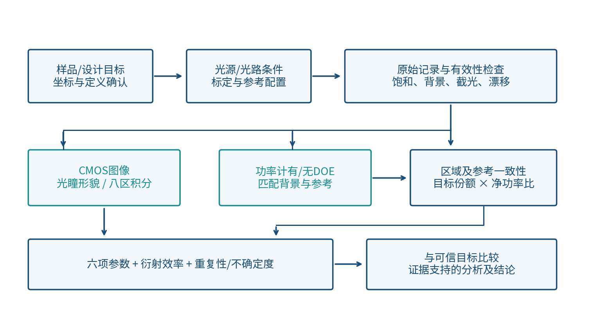
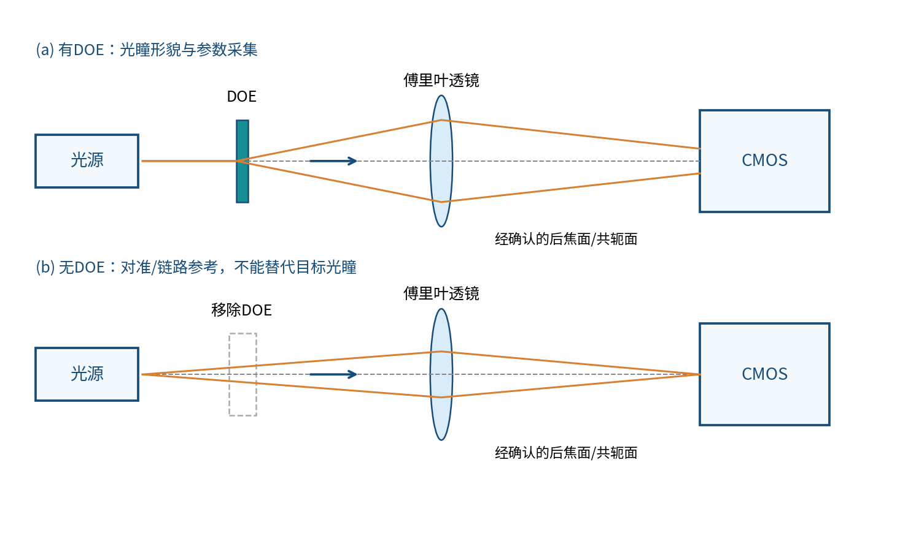
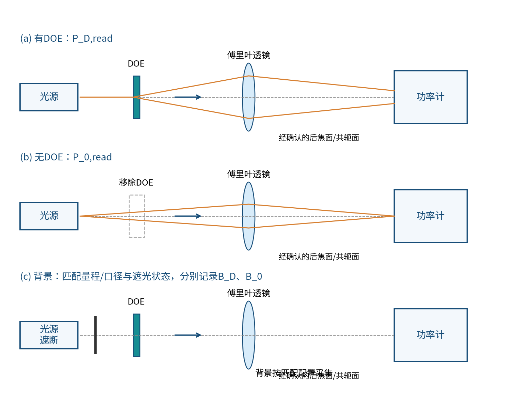
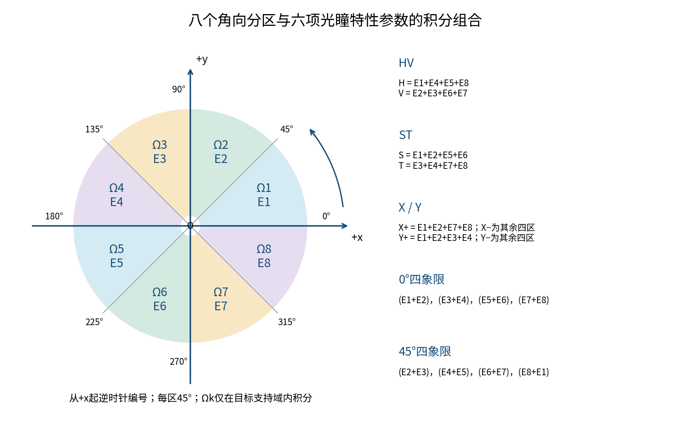

# 四极照明DOE光学性能实验报告

**公开方法草稿 v0.1｜实测图片、结果与结论待内网补充**

编制日期：2026年11月12日。实验对象为加工后的单个四极照明DOE。本文按“实验目的与技术路线、实验设计与方案、实验结果与分析、附录”四章编制，已补充背景、理论与方法，尚未接入实测图片、功率读数和参数计算结果。第三章的图位、表格及待填项不代表测试已经完成。

目标值及允许公差未知时用加粗 **？？？** 表示；实际条件、实测结果及证据缺口用“【内网待填：……】”区分，不以问号或合成示例冒充测量值。本稿默认保留六项光瞳参数的既有候选归一化定义，须与内网实际计算程序核对后冻结。若最终有目标机模板，以其实际要求适配版式，四个主章保持不变。

**目录**

一、实验目的与技术路线：应用背景、实验目的、理论依据、技术路线与评价范围。

二、实验设计与方案：样品和条件、CMOS与功率计测量、八分区及六项公式、效率与不确定度。

三、实验结果与分析：实测材料与有效性、光瞳分布、特性参数、衍射效率及综合分析。

四、附录：实际记录、公式版本、处理追溯、不确定度、内网补写与参考文献。

## 一、实验目的与技术路线

### 1.1 应用背景

衍射光学元件（diffractive optical element，DOE）通过空间相位或振幅结构调制入射波前，使能量在规定输出面形成所需分布。本报告关注加工完成的相位整形器件在投影光刻照明系统中的四极照明应用，评价器件实物在规定测试条件下对设计光瞳的实现程度。

照明光瞳描述不同照明方向的能量权重。四极照明在指定的四个角向区域形成照明能量分布，极的位置、范围和相对能量共同构成目标。四极并不意味着每极必然等能或具有相同尺寸，实际目标应来自设计文件；实验测得的强度也不能仅因出现四个亮区就判为满足设计要求。

系统照明光瞳、掩模场面和晶圆像面是不同平面与物理对象。照明分布与掩模频谱、投影物镜孔径及像差、离焦、偏振和相干条件共同影响成像。[1] 本报告仅评价单个DOE的光学输出，不由台架光强图推断晶圆图形、焦深、线宽控制或工艺窗口已经改善。

### 1.2 实验目的与评价范围

实验围绕三类证据展开：二维光瞳场分布、光瞳特性参数及目标区衍射效率。首先记录四极图样的空间结构，检查各极是否出现在规定位置，观察支持域、边缘、零级与域外能量；其次以统一坐标和固定分区计算六项参数；最后关联功率计读数与相机目标能量比例，给出明确参考配置下的效率。

六项参数包括HV椭圆度、ST椭圆度、X极平衡、Y极平衡、0°四象限极平衡及45°四象限极平衡。它们用于描述指定区域间的能量分配；所采用的公式、方向约定和分区必须同时给出，单独一个指标名称或百分数不构成可复核结果。四极张角、方位角作为可选补充项，只有在本次实际测量范围及边缘定义确认后才进入结果表。

本报告不包含横向CD、套刻误差、刻蚀深度和整体尺寸的结构验收。若讨论制造偏差对光学结果的影响，只能引用允许使用的实际结构记录或可信模型作为辅助证据，不能从光场图直接诊断某一加工参数超差。

### 1.3 设计与测量的理论依据

#### 1.3.1 GS相位设计与实物输出

设DOE设计输入面的振幅为A₀(x,y)，目标面强度为T(X,Y)，目标振幅应为√T。基本GS通过两平面传播及振幅约束交替更新相位，可写为：[2]

Uₖ=A₀exp(iφₖ)，Vₖ=P[Uₖ]；

V′ₖ=√T exp(i arg Vₖ)，φₖ₊₁=arg(P⁻¹[V′ₖ])。

下一轮重新施加输入振幅约束。P表示与所选目标面一致的传播算子，不能在未确认几何时默认任意远场与焦面相同。实际设计若采用加权、自由噪声区或量化约束，应记录其真实算法版本，不因参考软件具有这些功能就认定本器件也采用了它们。

加工后DOE的相位实现还受到量化、实际入射场、表面和安装条件影响。理想设计输出、考虑加工实现的预测输出和实测图样应分别标识。没有实际相位及模型输入时，不填造收敛曲线、理论效率或仿真光瞳。

#### 1.3.2 标量衍射与傅里叶透镜

采用薄元件近似时，DOE后复场可表示为U₀=A_in·t·exp(iφ_DOE)，t包含有效孔径与振幅透过率。以exp(−iωt)为时间约定，标量角谱传播为：[3]

U_z=F⁻¹{F[U₀]H_z}，H_z(fₓ,fᵧ)=exp[i2πz√(λ⁻²−fₓ²−fᵧ²)]。

λ为传播介质中的波长，倏逝分量采用正向衰减分支。傍轴近似下可采用Fresnel形式。理想薄透镜相位为t_L=P_Lexp[−ik(x²+y²)/(2f)]。若DOE到透镜距离为d、透镜到探测面距离为z，应以U_det=P_z{t_L·P_d[U₀]}建立与实际配置一致的模型。[3–4]

在相应傍轴与孔径条件成立、探测面位于确认的后焦面时，焦面强度与入射复场傅里叶变换模平方相关，频率坐标满足fₓ=X/(λf)、fᵧ=Y/(λf)。离散焦面采样满足ΔX=λf/(NₓΔx)、ΔY=λf/(NᵧΔy)。数值补零可加密采样，但不会增加实物结构信息或相机分辨能力。[4]

标量模型并非无条件成立。特征尺度接近波长、高NA、明显偏振耦合或复杂材料结构时，需要评估薄相位、标量和傍轴假设的局限。模型适用性及收敛检查结果尚待设计输入和实际条件支持，本稿不预先宣称已经验证。

#### 1.3.3 测试面与系统光瞳

CMOS首先记录台架测试面上的响应。只有明确共轭关系、放大率、光轴位置、方向和必要畸变，才能把图像解释为规定的系统照明光瞳。可用经标定映射s=M(u,v)将相机像素坐标变换为物理或归一化光瞳坐标；该映射来自光学设计或校准，不能为使图样吻合而自由拟合。

局部傍轴测试坐标可与该台架传播方向近似对应，如θₓ≈X/f、θᵧ≈Y/f；它不等于完整系统的归一化源坐标。若使用σ等照明NA归一化量，必须明确参考侧、介质和投影NA。映射证据不足时，结果按“测试面四极光强分布”表述，不写成系统光瞳已经完成标定。

### 1.4 技术路线

技术路线由目标和坐标确认开始，经过光学条件核对、两类采集及有效性检查，再进入统一数据处理。六项参数与效率共享样品、坐标和目标区域版本，但使用不同观测量：相机提供空间相对分配，功率计提供指定收集域的积分功率。

在采集前冻结指标定义，在数据处理前核查参考配置，在形成结论前核对证据与设计条件。连续图像帧、独立重新采集与器件复装分别记录，避免将相关帧数误当独立实验次数。

## 二、实验设计与方案

### 2.1 样品、目标与方向基准

测试对象为加工后的单个四极照明DOE。表1用于内网接入真实记录，当前未填写的字段不表示已经确认。

| 表1 样品与目标字段 | 实际记录 | 用途 |
| --- | --- | --- |
| 样品编号、设计/加工版本 | 【内网待填：样品及版本】 | 串联图像、功率与处理结果 |
| 设计目标图及文件摘要 | 【内网待填：目标文件与摘要】 | 确认支持域、权重及比较对象 |
| 四极类型、极编号与目标方向 | 【内网待填：角区、首极和方向】 | 防止镜像/旋转与极区错配 |
| 入射面、出射面及机械基准 | 【内网待填：标记与朝向】 | 复装、定位与方向追溯 |
| 各极能量权重及目标适用条件 | 【内网待填：是否等权及条件】 | 解释平衡量和设计偏置 |
| 目标值与允许公差 | **？？？** | 仅在判据确认后用于符合性评价 |

图示的四极方向或八分区不自动构成实际设计目标。若器件设计整体旋转，应以机械基准记录其目标方向，不能将图像任意旋正后宣称方向符合。

### 2.2 设备、条件与标定记录

测量路线与既有方案一致，[5] 具体仪器及实际执行条件需由内网日志补齐。本文方法说明不替代“已校准”“已测量”的实际证据。

| 表2 条件类别 | 必须记录的内容 | 缺失时的主要限制 |
| --- | --- | --- |
| 光源与入射场 | 波长/谱宽、偏振、束径、入射功率时序、准直或波前信息 | 难以比较设计与实测 |
| DOE安装 | 朝向、位置、机械标记、复装及调焦记录 | 方向和重复性不明确 |
| 傅里叶透镜 | 型号、焦距、口径、位置、波段与透过率证据 | 尺度、截光与损耗不明确 |
| CMOS | 像元、位深、曝光、增益、线性、温度、背景及原始格式 | 灰度积分和边缘计算不可靠 |
| 功率计 | 探头、波段、量程、有效口径、接受角、响应与校准 | 功率和参考域不匹配 |
| 坐标与系统映射 | 光轴、尺度、旋转/镜像、畸变、共轭或角度映射 | 不能称为已标定系统光瞳 |
| 附加元件 | 实际使用的衰减器/滤光片等及校准 | 修正可能遗漏或重复 |

若原装置还包含准直、扩束、偏振控制或转接光学元件，应依据实际记录补入装置说明与损耗账目。本稿示意图未画出这些元件，不表示现场已有、无需或已经使用。

### 2.3 CMOS光瞳场采集

采用光源—DOE—傅里叶透镜—CMOS链路获取二维图像。CMOS位于确认的后焦面，或具有已知中继映射的共轭面；替换探测器或改变转接配置后，应核对尺度与接收范围。图2仅为原理示意，不代表实际装置照片。

采集与检查按以下顺序登记：

1. 在无DOE配置建立光轴和探测面参考，记录调焦、位置和方向。参考直射光不得饱和，无DOE图不能替代目标四极图样。
2. 按标记安装DOE，记录样品朝向、装调和最终位置。调焦依据预定规则进行，不能以主观“图更好看”改变测量面。
3. 关闭或记录自动曝光、自动增益、伽马与其他非线性处理，保存原始无损线性数据及元信息。仅有截图/JPEG时，应先确认其是否仍支持定量处理。
4. 在匹配曝光、增益、温度和装置状态下采集背景。区分电子暗场与光学背景，声明最终扣除包含的分量；不能把同一背景重复相减。
5. 检查饱和、截顶、坏点、拖影、裁剪和漂移；去噪或坏点替代规则预先确定，保存原始数据及处理记录，不按结果是否接近目标选择处理方式。
6. 按既定次数采集独立记录；连续帧、重启采集和器件复装分别编号。次数与时间序列由实际日志填写，当前不预设为已经完成。

背景扣除后出现负值时应先检查其分布、噪声和积分影响，不默认截零。若定量信号不足、饱和或视场遗漏无法界定，相关参数应标不可可靠估计，而不是填零或以归一化掩盖问题。

### 2.4 功率测量及有／无DOE参考

衍射效率采用功率计与光场图像关联计算，功率链路为光源—DOE—傅里叶透镜—功率计。功率计替换相机时，保持或标定探测面、收集口径和接受角的对应关系。图3中的无DOE参考为移除整个DOE后的配置；空白基片如另有使用，应单独记录其用途，不能混作同一参考。

首先明确效率分母。本文沿用相对于无DOE参考配置的目标区效率作为可直接复核的候选口径；如实际指标要求以DOE入射面功率为分母，则须另有入射功率及下游传输校准证据，不能仅改指标名称。

测量记录包括有DOE读数P_D,read、对应背景B_D、无DOE读数P_0,read及背景B_0，净功率分别为P_D=P_D,read−B_D、P_0=P_0,read−B_0。背景与探头位置、量程、衰减及光源遮断状态一致，明确仪器是否已执行自动归零，以免再次扣除。

建议采用无DOE参考—有DOE样品—无DOE参考的夹测记录，或经过验证的独立监测通道评估光源漂移。实际采用哪条路线由日志说明；夹测参考发生突变时，不能强行插值为稳定参考。先逐组计算效率，再统计重复记录，均值的比值与比值的均值不能不加说明地互换。

定义共同收集域A，使功率计实际积分范围与相机的分母积分范围在同一平面/映射、孔径及接受角意义上一致。探头直径与相机视场尺寸相近不足以证明接收域一致；必须检查离轴响应、透镜截光和可见域外级次。若共同域不能确认，应调整接收配置或给出经验证的换算，不能直接套用效率公式。

相机确定目标区Ω_T在A内的净能量占比，功率计确定A内净功率。若功率计已通过空间选择只测目标区，则不再乘一次目标占比。透镜、衰减器、选择孔径和响应校正逐项建立账目；有／无DOE角分布不同，共用透镜也不能无证据认定损耗完全抵消。

### 2.5 八分区与六项光瞳特性参数

#### 2.5.1 坐标、目标域与积分

以标定光瞳中心O为原点，+x为0°，+y为90°，逆时针为正，θ=atan2(y,x)，按0°≤θ<360°表示。用x/y轴与两条对角线形成八个45°扇区：从+x上方的0°—45°起，逆时针编号Ω₁至Ω₈，并与冻结的目标支持域Ω_T取交集。这里是八个角向分区，不是八个笛卡尔象限。

Ω_k=Ω_T∩{45°(k−1)≤θ<45°k}，E_k=Σ_i w_i(Ω_k)C_i，k=1，…，8。

S₈=E₁+E₂+E₃+E₄+E₅+E₆+E₇+E₈=E(Ω_T)。

C_i为匹配背景扣除和已验证响应校正后的净线性像素信号；可写为C_i=(R_i−D_i)/g_i，g_i只有在存在实际平场标定时才使用，无标定时保留其假设与限制。w_i为像元与区域的交叠比例及经过验证的响应权重。直接累加DN时不再无依据乘一次像元面积；若输入为辐照度密度，则按实际面积积分，处理入口需注明单位。

边界采用半开归属或面积分摊，不双计；原点不具有角度，跨原点的有限像元按面积分配。坐标、支持域与掩膜在处理前冻结，不为每个指标重新定中心或改变裁剪范围。重新采样时保留能量守恒，保存原始与变换后的图。

#### 2.5.2 六项参数公式与符号

六项名称已确认；以下公式延续前一方案的项目候选归一化方式，尚不代表设计方或行业统一标准。内网应先比对实际计算程序的角区、符号、分母和百分数尺度，再冻结定义版本。设H=E₁+E₄+E₅+E₈、V=E₂+E₃+E₆+E₇；S=E₁+E₂+E₅+E₆、T=E₃+E₄+E₇+E₈，S/T在本稿对应45°/225°与135°/315°两组方向。

HV椭圆度：ε_HV=100%×[(E₁+E₄+E₅+E₈)−(E₂+E₃+E₆+E₇)]/S₈。

ST椭圆度：ε_ST=100%×[(E₁+E₂+E₅+E₆)−(E₃+E₄+E₇+E₈)]/S₈。

X极平衡：B_X=100%×[(E₁+E₂+E₇+E₈)−(E₃+E₄+E₅+E₆)]/S₈。

Y极平衡：B_Y=100%×[(E₁+E₂+E₃+E₄)−(E₅+E₆+E₇+E₈)]/S₈。

ε_HV和ε_ST描述两组方向的能量差，不是几何椭圆长短轴比。B_X、B_Y分别描述右减左、上减下的半域能量差，不等同于质心偏移。保留正负号，零值为相应两组等能。若实际X/Y指标比较指定完整极对，应以既有极区定义核对，不默认为左右/上下半域。

0°四象限以边界从+x开始命名，其四组能量为Q⁽⁰⁾=(E₁+E₂，E₃+E₄，E₅+E₆，E₇+E₈)。45°四象限的边界整体旋转45°，四组能量为Q⁽⁴⁵⁾=(E₂+E₃，E₄+E₅，E₆+E₇，E₈+E₁)。定义：

b_j⁽⁰⁾=100%×[4Q_j⁽⁰⁾/S₈−1]，B_Q0=max_j(abs(b_j⁽⁰⁾))，j=1，2，3，4。

b_j⁽⁴⁵⁾=100%×[4Q_j⁽⁴⁵⁾/S₈−1]，B_Q45=max_j(abs(b_j⁽⁴⁵⁾))，j=1，2，3，4。

两项四象限汇总量均为相对于四区平均能量的最大绝对偏差，单位为%，0为等能基准；四个有符号b_j同时留存。该定义不等于“最大最小差/总能量”。如果设备以象限中心角命名0°/45°，名称可能互换，应按已确认的编号图校正。

比值型椭圆度R_HV=H/V、R_ST=S/T可作为另一种口径记录，但不得与上述差值型混用目标、公差或结论。相同分区下，未乘百分数的归一化差d与比值r满足d=(r−1)/(r+1)，比值等能基准为1。若设计为非等权目标，四象限偏差可按100%×[(Q_j/S₈)/w_j−1]评价，其中w_j>0、Σw_j=1来自设计；零权区域另作杂散观察。方法改变后必须记录版本，不能只替换数字。

所有比例需可信正分母。负净信号、饱和或分区无有效信号时，先判断可计算性和适用性，不把无效输出填成0。目标值及允许公差为 **？？？**，没有实际判据时不写“六项均合格”。

### 2.6 衍射效率计算

在共同域A和目标域Ω_T已确认、相机处于可信线性响应条件时，目标能量占比为：

q_T|A=E(Ω_T∩A)/E(A)。

相对于无DOE参考配置的目标区效率为：

η_rel,T=(P_D/P_0)·q_T|A；百分数显示为100%×η_rel,T。

P_D为有DOE配置在A内的总收集净功率，P_0为可比无DOE配置在A内的净参考功率。q仅表示相机图像中的相对分配，不将DN或DN之和直接转换为W。相机裁剪遗漏的级次或目标能量必须记录，不能因帧内目标比例接近1就判断器件效率接近100%。

若实际已直接测到目标功率P_T,det，应以P_T,det/P_0计算相应参考效率，不再乘q。若要求器件入射面定义的效率，则写为η_DOE,T=P_T,exit/P_inc；由探测面反推DOE输出面的功率必须有下游有效传输校准。角度依赖强时采用分区或积分校正，不能用未经验证的单一透镜系数替代。

报告中应随效率一起列出名称、分母、测量面、共同域、空间选择方式和修正版本。两种效率不能用一个“衍射效率”名称混报；相机目标区比例也不能独立替代绝对或相对参考效率。

### 2.7 重复性、不确定度及可选角度

独立有效重复n>1时报告均值、样本标准差s及均值A类标准不确定度u_A=s/√n；n=1时不填造标准差。空间上八个分区的差异不是同一量的重复测量，不能用它们的离散度代替采集重复性。连续帧相关性、装调漂移和器件复装应分别考虑。

对y=f(x)，合成标准不确定度可用u_c²=Σ_iΣ_j(∂f/∂x_i)(∂f/∂x_j)cov(x_i,x_j)评估。功率参考、背景、q、衰减与共同校准可能相关；共享分母的六项参数也不应默认独立。扩展不确定度U=k·u_c需说明k和覆盖依据，不将某个固定k无条件等同特定置信水平。完整预算见附录4.4。

如实际纳入四极张角和方位角，以标定中心为顶点，按确认的角向边缘提取规则求第j极局部连续边界θ_j,L、θ_j,R，α_j=θ_j,R−θ_j,L，β_j=(θ_j,L+θ_j,R)/2。α为单极在光瞳平面内的全张角，β为相对机械基准的中心方向，不是相对光轴的传播极角。跨零角先局部展开，四极图形的90°方向等价性与机械首极编号须区分；阈值、拟合和边缘模型未知时只保留待补记录，不先计算。

## 三、实验结果与分析

### 3.1 实测材料与数据有效性

**本章尚未接入内网实测图片和计算结果，当前不能形成性能结论。** 下列图位与结果表为真实数据预留，不含合成光瞳、模拟SEM图或虚构数值。内网补写时，应先核对实际实验记录是否与第二章方法一致；不一致处先更新实际方法与配置，再组织结果。

| 表3 实测材料状态 | 应接入内容 | 当前状态 |
| --- | --- | --- |
| 配置与校准 | 样品、波长/偏振、设备、几何、坐标映射及校准 | 【内网待提供】 |
| CMOS数据 | 原始无损图、匹配背景、曝光/增益、时间戳 | 【内网待提供】 |
| 功率记录 | 有／无DOE、各自背景、测量顺序与修正 | 【内网待提供】 |
| 参数输出 | 六项结果、八区积分、ROI、程序与定义版本 | 【内网待提供】 |
| 设计对比材料 | 目标图、能量权重、判据或可信仿真 | 【内网待核对可用范围】 |

有效性复核包括饱和、背景、视场/孔径截光、分母信噪、坐标映射和参考漂移。原始记录未提供或某项检查没有证据时，状态保持“未核对”，不将空白表格解释为已经通过。排除记录写明原因、影响指标与替代采集ID。

### 3.2 实验装置与光瞳场分布

[[BLANK 图5 实际实验装置照片及关键器件标注；内网补入，原理图不能替代实物照片]]

【内网待填：实际装置与图2、图3的对应关系，增加或省略的元件、位置和测试日期；引用配置ID及原始照片ID。】

[[BLANK 图6 同一配置下的原始光瞳图与匹配背景图；内网补入，分别标注曝光、增益、单位和图像ID]]

【内网待填：原始动态范围、背景水平、饱和/坏点/裁剪核查及采用的数据有效性结论。】相机显示图若仅供观察，应与用于积分的原始数值图分开，注明对比度调整或对数显示，不用显示增强图替代定量输入。

[[BLANK 图7 背景扣除后的四极光强分布及固定ROI叠加；内网补入，标坐标、色标、原点、八区与共同域]]

【内网待填：四极位置、形貌、支持域与能量分布的实际观察；说明图7是已标定光瞳坐标还是仅为测试面坐标。】对零级、旁瓣或域外信号只描述图像实际支持的范围；目标内零级是否计入由设计定义，不重复剔除。画面外能量未知时明确其限制。

### 3.3 设计目标与实测分布对比

[[BLANK 图8 设计目标与实测光瞳在统一坐标下的对比；有可信目标时内网补入，无目标则保留缺口说明]]

比较时统一物理尺度、方向、像元积分与目标域。分别记录未配准差异和经允许变换后的差异，不以自由旋转、拉伸或重新裁剪掩盖器件方向与尺度偏差。图样分别归一化用于形貌比较时，应说明总能量差已被去除，不能再据此评价效率。

【内网待填：目标图版本、配准与归一化规则，以及各极实际偏差。】如无可用目标或真实仿真，只讨论实测形貌和重复一致性，不构造“理论曲线”或报告未经计算的相似度。额外质心、形貌误差或域外占比若计算，应标为辅助量，不替代六项特性参数。

### 3.4 光瞳特性参数结果

先核对实际程序与2.5定义的一致性，再录入表4。若内网采用比值型或其他规范公式，应同步更新正文定义、符号、单位、目标和表头，保留版本差异；不能在差值型公式下填入比值型结果。

| 表4 参数 | 实测统计量 | 不确定度/重复口径 | 目标/允许偏差 | 当前结论 |
| --- | --- | --- | --- | --- |
| HV椭圆度 | 【内网待填】 | 【内网待填】 | **？？？** / **？？？** | 待数据及口径确认 |
| ST椭圆度 | 【内网待填】 | 【内网待填】 | **？？？** / **？？？** | 待数据及口径确认 |
| X极平衡 | 【内网待填】 | 【内网待填】 | **？？？** / **？？？** | 待数据及口径确认 |
| Y极平衡 | 【内网待填】 | 【内网待填】 | **？？？** / **？？？** | 待数据及口径确认 |
| 0°四象限极平衡 | 【内网待填】 | 【内网待填】 | **？？？** / **？？？** | 待数据及口径确认 |
| 45°四象限极平衡 | 【内网待填】 | 【内网待填】 | **？？？** / **？？？** | 待数据及口径确认 |

表4默认上述候选量以%表示；带符号量相对于目标偏差评价，非负汇总量根据已确认上限评价。实际重复数、统计方式和单位由有效记录填写。没有目标/公差时，可完成性能测量与误差讨论，但不形成合格与否结论。

| 表5 八区积分 | 净积分及单位 | 表5 八区积分 | 净积分及单位 |
| --- | --- | --- | --- |
| E₁（0°—45°） | 【内网待填】 | E₅（180°—225°） | 【内网待填】 |
| E₂（45°—90°） | 【内网待填】 | E₆（225°—270°） | 【内网待填】 |
| E₃（90°—135°） | 【内网待填】 | E₇（270°—315°） | 【内网待填】 |
| E₄（135°—180°） | 【内网待填】 | E₈（315°—360°） | 【内网待填】 |

[[BLANK 图9 八分区净能量及六项参数的实际统计图；内网根据表4、表5生成，注明归一化和误差条含义]]

【内网待填：HV/ST反映的方向能量差、X/Y反映的半域偏置、两套四象限的最大偏差及对应区域。】同时检查四个b_j和各区能量，不能仅据一个最大值推断某个完整极异常。均匀环形分区示意不等于实际四极各分区均应等能；对非等权目标按已确认设计权重解释。

如果张角、方位角被纳入本次范围，另附逐极边界、α_j、β_j、圆周误差及边缘提取证据；否则标为“未纳入本次范围”，不补写数值，不让可选项阻塞六项参数和效率的记录。

### 3.5 衍射效率结果

| 表6 功率与图像量 | 原始/背景记录 | 净值或比例 | 参考与修正 |
| --- | --- | --- | --- |
| 有DOE配置 | 【内网待填：读数、B_D】 | 【内网待填：P_D及单位】 | 【内网待填】 |
| 无DOE配置 | 【内网待填：读数、B_0】 | 【内网待填：P_0及单位】 | 【内网待填】 |
| 目标域与共同域积分 | 【内网待填：图像/掩膜ID】 | 【内网待填：q_T∣A】 | 【内网待填：域一致性】 |
| 效率 | 【内网待填：公式/版本】 | 【内网待填：效率及单位】 | 【内网待填：参考平面】 |

【内网待填：逐组功率、漂移处理、目标比例、效率及不确定度，引用附录原始记录。】清楚区分图像占比、无DOE参考效率和入射面定义的器件效率。若探头直接只测目标，表6需注明并取消再次乘q的步骤；不得同时重复校正。

[[BLANK 图10 衍射效率及参考功率稳定性/重复性图；内网按实际记录生成，不预设次数、误差条或达标线]]

效率变化应先排查参考稳定性、背景、曝光/响应、域匹配与修正，再讨论器件能量分配。若目标占比高而参考效率低，仍可能存在器件透射损失、测量链路截光或参考不匹配，不能单凭一个比例认定原因。效率超出合理物理范围时查明账目，不截到100%或无记录删除。

### 3.6 综合分析与结论

综合分析围绕“形貌—能量分配—总目标功率”三条证据链展开。图样相似不证明效率高，目标区效率高也不证明六项分配均满足要求；三类结果应在相同样品和适用条件下联合解释。

| 表7 待验证的差异方向 | 候选解释 | 需要的区分证据 |
| --- | --- | --- |
| 各极位置、尺度或方向偏离目标 | 坐标标定、波长/焦距、安装方向、器件实现 | 标定、装调、设计与实测坐标 |
| HV/ST或X/Y偏置 | 入射场偏置、裁剪、响应、设计权重、相位实现 | 入射场、ROI、平场、复装与目标定义 |
| 两套四象限不平衡 | 区域权重、极边界、图像截光、真实能量差 | 八区积分、逐区偏差、原图与掩膜 |
| 效率偏低或不稳定 | 参考漂移、损耗、收集不足、目标外能量 | 有/无DOE时序、收集域及修正账目 |

表7仅列分析路径，不是本器件已经出现这些差异的记录。原因认定须有独立测量、受控条件变化或可信模型支持。只存在相关现象时采用“可能”“尚待验证”等与证据强度一致的表述。

【内网待填：在实际波长、入射条件和配置下，四极形貌与六项参数的测得结果、效率及不确定度；与已确认目标的比较；已排除/未排除的误差来源；结果适用范围和后续工作。】

当前结论状态为“待实测材料补齐”。在原始材料、定义、条件或关键误差未关闭前，不写“验证成功”“满足全部指标”或“已改善光刻工艺性能”。

## 四、附录

### 4.1 实际条件、原始文件与材料索引

将内网原始资料保留在本项目独立目录，接入时登记文件名、版本、单位、时间和摘要。原件不覆盖，提取和处理件另存；这里只给字段，不填写虚构文件。

| 表A1 材料ID | 实际文件与内容 | 版本/摘要、采集条件 | 对应正文 |
| --- | --- | --- | --- |
| SETUP-001 | 【内网待填：装置、几何及校准记录】 | 【内网待填】 | 2.1—2.4、3.1 |
| TARGET-001 | 【内网待填：设计目标及权重】 | 【内网待填】 | 2.5、3.3—3.4 |
| IMG-001/002 | 【内网待填：原始光瞳与背景】 | 【内网待填：曝光等】 | 3.2 |
| MASK-001 | 【内网待填：目标、共同域与分区掩膜】 | 【内网待填：坐标及版本】 | 2.5—2.6、3.4—3.5 |
| POWER-001 | 【内网待填：功率原始时序及背景】 | 【内网待填：单位与配置】 | 3.5 |
| CALC-001 | 【内网待填：程序/计算表及输出】 | 【内网待填：公式版本】 | 3.4—3.6 |

### 4.2 计算口径与修正账目

六项公式集中见2.5，效率见2.6。附录不另建不同版本公式，而登记实际程序与正文是否一致，包括八区起点、旋转/镜像、S/T命名、四象限边界、比值/差值、百分数、目标权重及负值处理。程序自动输出的“ellipticity”“efficiency”等字段必须先确认分母和尺度，不能仅按名称填表。

| 表A2 修正项目 | 原始量与校准依据 | 应用位置/是否已应用 | 不确定度与限制 |
| --- | --- | --- | --- |
| 背景/仪器归零 | 【内网待填】 | 【内网待填：只扣一次】 | 【内网待填】 |
| 曝光/响应/平场 | 【内网待填】 | 【内网待填：有无有效校准】 | 【内网待填】 |
| 衰减/滤光元件 | 【内网待填：若实际使用】 | 【内网待填】 | 【内网待填】 |
| 透镜/孔径/离轴响应 | 【内网待填】 | 【内网待填：损耗边界】 | 【内网待填】 |
| 光源漂移与参考时刻 | 【内网待填】 | 【内网待填：配对/插值规则】 | 【内网待填】 |

没有记录某个修正不代表其数值为零或系数为1。对无适用校准的数据，应声明限制并评估是否仍能支持所报告指标。

### 4.3 数据处理与重复记录

处理顺序为：核对原始元信息 → 有效性检查 → 匹配背景及响应处理 → 固定坐标和区域 → 八区积分/六项指标 → 共同域目标比例 → 配对净功率和效率 → 独立重复统计及误差 → 图表输出。每次运行保留输入摘要、程序版本、参数文件、输出和排除清单，不使结果仅依赖聊天记录或人工复制。

| 表A3 记录字段 | 填写要求 |
| --- | --- |
| 采集ID/配置/时间 | 【内网待填：连续帧、独立采集、复装分别编号】 |
| 图像与功率关联 | 【内网待填：样品、光源条件与时刻对应】 |
| 有效性及排除理由 | 【内网待填：不得只保留达标记录】 |
| 程序/参数/掩膜版本 | 【内网待填：可重复计算】 |
| 逐次与汇总输出 | 【内网待填：同时保留，说明统计方式】 |

既有公开研究包的合成脚本不是本项目全套分析软件。其实际能力有限，不能假定已实现八分区、六项指标、所有光学映射或完整不确定度。本轮没有接入内网程序，也没有运行实测计算；后续应核对真实程序，必要时先用清楚标注的解析/合成输入验证计算逻辑，再处理实测材料。合成验证数值不进入第三章实测结果。

### 4.4 不确定度预算与结果表达

| 表A4 来源 | 影响量 | 评估证据/方法 | 当前记录 |
| --- | --- | --- | --- |
| 读数与采集重复性 | 六项参数、q、功率/效率 | 独立记录、相关性与实际样本数 | 【内网待填】 |
| 暗场/光学背景 | 净图积分、净功率 | 匹配背景时序、漂移与量程 | 【内网待填】 |
| 响应、线性及校准 | 图像比例、功率 | 校准证据、适用波段和范围 | 【内网待填】 |
| 坐标及分区 | 六项参数、可选角度 | 中心/尺度/旋转、边界敏感性 | 【内网待填】 |
| 收集域与修正 | q、效率 | 孔径、接受角、衰减与损耗 | 【内网待填】 |
| 复装与光源漂移 | 方向、能量及效率 | 复装记录、夹测或监测 | 【内网待填】 |

报告单次结果、均值、样本标准差、标准不确定度或扩展不确定度时分别标识；参数以%表示时，不确定度的同单位差值应注明为百分点，不能与相对百分不确定度混淆。误差条说明代表什么，未评估时如实标明，不绘制任意长度。

若需符合性判断，先确定目标、公差与决策规则；测量不确定度接近边界时可按已确认规则复测或标临界。没有判据和完整证据时只报告性能，不自行套用前一方案的候选保护带为合同要求。

### 4.5 图像和结果补入规范

图5—图10为内网补入位置，当前留白。图像至少写明材料ID、采集/处理状态、坐标及单位、色标、原点和支持域；不同图比较时采用同一坐标和明确的色阶策略。若用对数显示、截断色标或独立归一化，在图注说明，计算仍来自原始或已声明的定量输入。

实拍图标“实测”，处理图写明处理步骤，目标/仿真图注明其来源与版本。不能将原理图当装置照片，不能用合成四极图填补真实图片。保留图号与正文引用；新增结果图按实际逻辑调整编号，并核对所有关联表格。

### 4.6 内网接续与完成检查

内网接续先读取本机有效规程及当前仓库规范，核对交付模式与实际模板。将允许带入的公开稿复制至新项目工作目录，实测原件在内网独立保存；材料接入后更新2.1—2.4的实际条件和方法，再填写第三章。发现实际执行与原定方法不同，记录变化及影响，不将原计划直接改为过去时冒充实施日志。

完成前逐项检查：目标与实际条件可追溯；六项公式和程序一致；图片与数值来自同批或可比条件；功率及图像域匹配且修正不重复；不确定度与统计明确；异常记录完整；分析不超过证据；目标应用中的Word保存重开与逐页排版完成。当前内网数据、计算复核和目标机Word验收均未执行。

本报告及后续工作目录与旧验收方案分别管理。内网实拍图、功率记录、参数结果与内部日志不自动回传或上传公开仓库；本次公开稿只含方法、空白记录及明确的待补项。

### 4.7 参考文献与资料

[1] Chen G, Geng H, Yu B, Pan D Z. Differentiable Computational Lithography Framework. 作者讲义，2024-03-06，第11—12、15—17页。https://github.com/TorchOPC/TorchLitho/blob/027cf8a9ec3ebda3b0ae9902313d7c856e67af03/misc/slides/torchlitho.pdf 。本稿实际查阅既有公开研究包的自写笔记和支持位置，未在本轮重新读取讲义全文；用于系统层级概念，不是本DOE性能证据。

[2] Holodyne Labs. slmsuite: _hologram.py. 固定提交5ac5a19ac356fe238a54db8a0a6be7114f085cf8，GS交替约束与实现。https://github.com/holodyne/slmsuite/blob/5ac5a19ac356fe238a54db8a0a6be7114f085cf8/slmsuite/holography/algorithms/_hologram.py 。本稿查阅研究包内节选与笔记，不冒充原始GS论文全文。

[3] Bezzam E. waveprop. 固定提交84c3e7dd50c7193e4c069a7581740ecbf33a3167，Fraunhofer、Fresnel、角谱传播实现。https://github.com/ebezzam/waveprop/tree/84c3e7dd50c7193e4c069a7581740ecbf33a3167/waveprop 。本稿查阅研究包的实现节选与模型笔记，未运行该软件。

[4] LightPipes Developers. LightPipes/lenses.py. 固定提交cd965c9469bb53bbae2bf185d38c1107408cd5b5，Lens和LensFarfield。https://github.com/opticspy/lightpipes/blob/cd965c9469bb53bbae2bf185d38c1107408cd5b5/LightPipes/lenses.py 。本稿查阅研究包内节选与笔记，支持薄透镜和焦面标度说明，不替代实际标定。

[5] HolyHighY/DocumentModify. DOE测试验收方案v0.1，提交268f37ed3f583fd8c25f5e4003dd4961fb452c0b。https://github.com/HolyHighY/DocumentModify/blob/268f37ed3f583fd8c25f5e4003dd4961fb452c0b/reports/doe-acceptance-plan/DOE测试验收方案-v0.1.md 。本项目复用其中公开测量路线、八分区及原理图；候选公式和方法建议不自动成为已确认标准。

来源说明：文献[1–4]的离线查阅证据位于仓库既有packages/report-001-doe-research-v2.zip解压后的references/notes与snapshots；本轮在本项目解压并核对54个清单文件一致。原始GS/Fienup论文此前未取得全文，未列为已核实原文。六项归一化、不确定度处理及操作建议须结合实际程序和条件确认；本文没有以公开示例替代本器件的测量或仿真。
